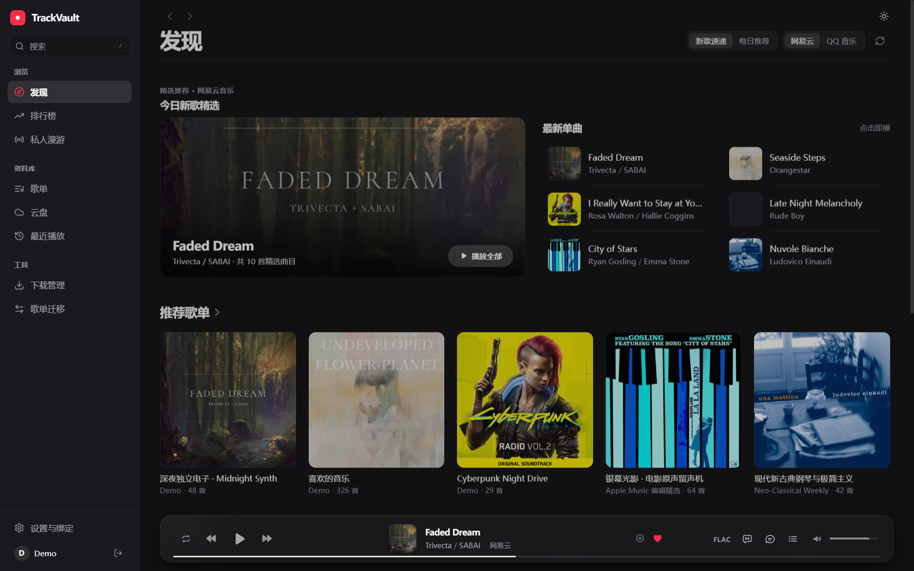
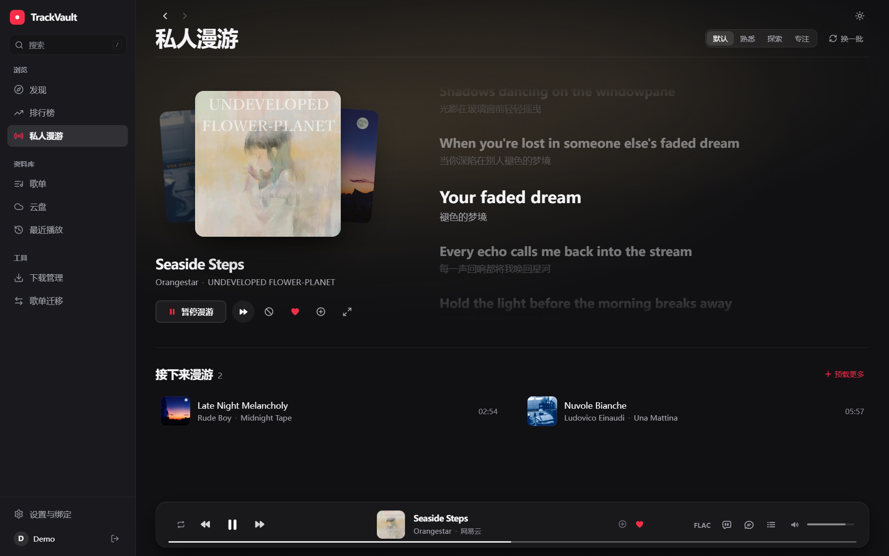
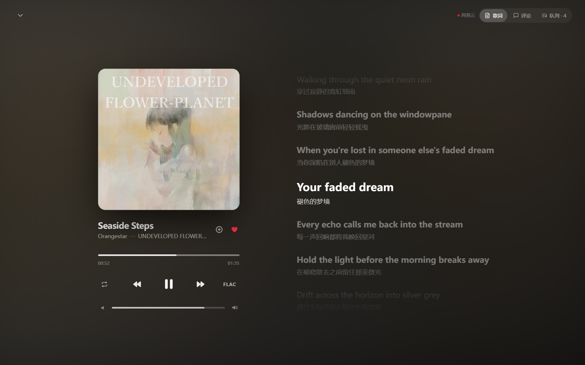
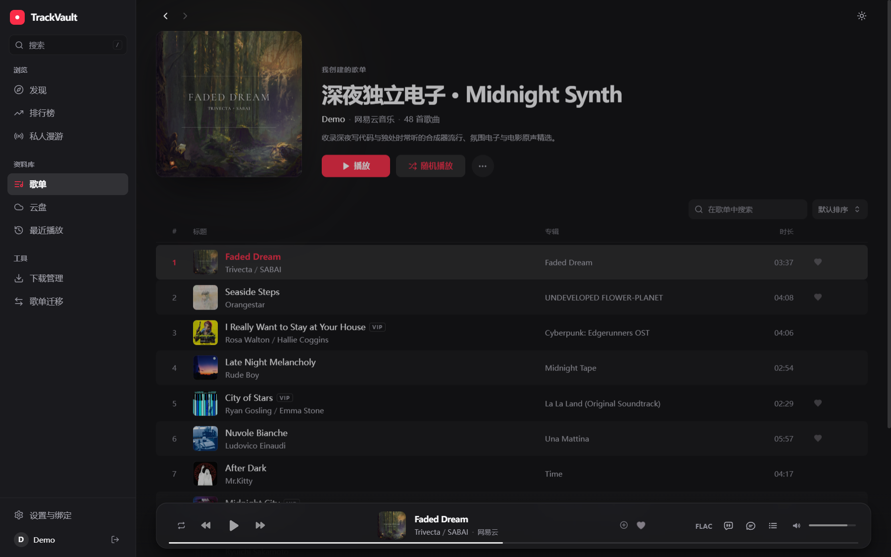
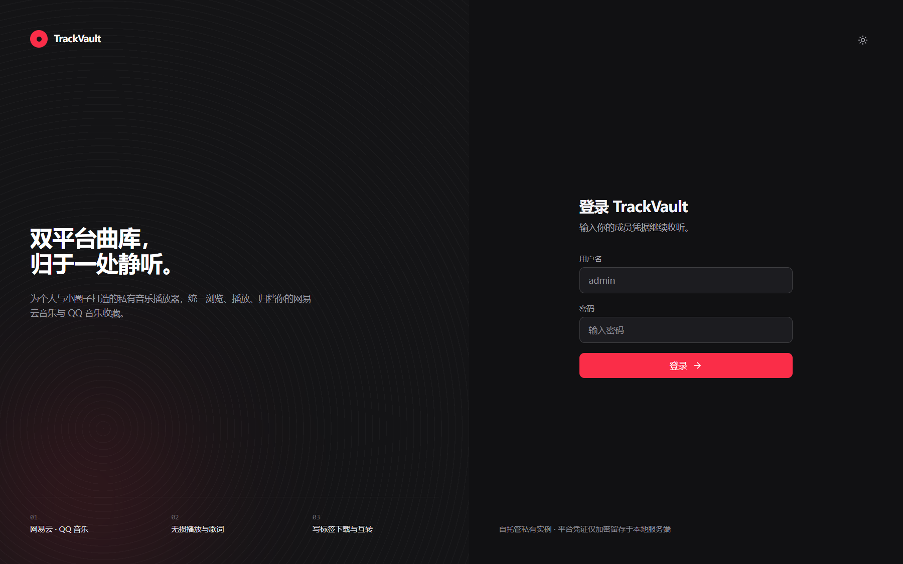

# TrackVault

私有自托管双平台桌面级音乐工作台（**网易云音乐 + QQ 音乐**），采用 macOS Apple Music / Liquid Glass 视觉体系、npm workspaces 单体仓库与严格前后端分层架构。

> **历史版本说明**：当前主线（`main`）为全新重构的 **TrackVault v2**。早期 Express 单体旧版已完整归档保留在 [`v1-legacy`](https://github.com/kuaichu/TrackVault/tree/v1-legacy) 分支与同名标签中。



## 界面预览

| 私人漫游电台（三联层叠封面 + 全画布取色柔光） | 全屏双语滚动歌词 |
| :---: | :---: |
|  |  |

| 歌单详情（无框大封面 + 斑马纹曲目表 + AppleSelect） | 私有实例成员登录页（黑胶纹路画布） |
| :---: | :---: |
|  |  |

---

## 核心特性

- **macOS Apple Music 桌面级交互体验**
  - 侧边栏全局快捷搜索、无边框画布与滚动吸顶毛玻璃标题栏、常驻 `< >` 历史栈导航、深浅色与跟随系统主题。
  - 底部悬浮 Liquid Glass 播放胶囊、全屏双语滚动歌词（支持逐字 YRC 与译文对齐）、实时音质切换菜单、一键红心与快捷收藏歌单气泡。
  - **私人漫游电台**：无框全画布封面取色氛围柔光（HSL 明度钳制防浅色封面发灰）、三联层叠景深封面栈、`默认 / 熟悉 / 探索 / 专注` 子模式切换、「不喜欢」垃圾桶调教推荐流，以及「接下来漫游 / 刚刚听过」双栏回溯。
  - 自定义 macOS 毛玻璃弹出选择器（`AppleSelect`）、大歌单虚拟滚动表格（`<SongTable>`）与路由级 `React.lazy` 按需分包。

- **双平台个人库与歌单工具**
  - 支持网易云扫码/Cookie 绑定与 QQ 音乐扫码/Cookie 绑定，所有第三方 Cookie 均通过服务端 `AES-256-GCM` 静态加密存储，绝不向前端回传明文凭证。
  - 支持多成员账号隔离与管理员系统保底凭证配置。
  - 跨平台歌单迁移（文本 / CSV / 网易云 / QQ 音乐）、双歌单差异对比、灰歌可用性实测审计与一键建单导入。
  - 网易云音乐云盘分页浏览与全量排队播放。

- **高品质流式播放与无损元数据下载**
  - 支持 `128K` / `192K` / `320K` / `FLAC` / `Hi-Res` 等多档音质探测与自动降级保护。
  - 零外部二进制依赖的纯 TypeScript 流式标签注入引擎（`packages/audio-tags`），下载自动写入高清封面、标题、歌手、专辑及双语歌词（ID3v2.3 / FLAC Vorbis Comment & Picture Block）。
  - 基于单调递增 `serverRevision` 的 SSE（`/api/events`）下载任务、互转进度与播放历史实时同步。

---

## 架构概览

```text
.
├── apps/
│   ├── server/          # Fastify 5 六边形架构后端 + node:sqlite 持久化
│   └── web/             # React 18 + Vite 6 + Tailwind CSS v4 (严格 FSD 分层)
├── packages/
│   ├── shared/          # 前后端唯一共享 Zod 契约、错误码与安全清洗工具
│   └── audio-tags/      # FLAC / MP3 二进制流式标签注入与 LRC/YRC 解析器
├── e2e/                 # Playwright 端到端回归测试套件
└── docker/              # 生产级多阶段 Dockerfile 与 docker-compose.yml
```

- `packages/shared`：前后端唯一 Zod 契约、稳定错误码 `ErrorCode`、安全 URL 校验、文件名清洗与 CSV 公式防注入工具。
- `packages/audio-tags`：零依赖 FLAC / MP3 二进制流式标签写入器（含魔数与越界保护）及统一 LRC / YRC 逐字歌词解析器。
- `apps/server`：Fastify 5 六边形架构后端（`interfaces/http` → `application` → `domain` → `infrastructure`），集成 `AES-256-GCM` `CredentialVault`、`SafeHttpClient` 逐跳白名单校验、连接池复用及 `AbortSignal` 透传取消。
- `apps/web`：严格 Feature-Sliced Design（FSD）分层架构（由自动化边界测试守卫），独立 `AudioEngine` 与 4Hz 播放时钟分片（播放期主组件树零重渲染）。

---

## 快速开始（需要 Node.js 24+）

```bash
cp .env.example .env
npm install
npm run dev
```

- 后端服务默认监听：`http://127.0.0.1:3010`
- 前端开发服默认监听：`http://127.0.0.1:5173`
- 首次访问页面将引导初始化管理员账号。

> **SMB / UNC / NFS 网络共享盘注意事项**
> 若代码仓库位于网络挂载路径（如 `\\server\share`、映射网络驱动器或 NFS），建议在 `.env` 中将 `DATA_DIR` 指向本机 SSD 路径（例如 `DATA_DIR=C:/TrackVaultData` 或 `/var/lib/trackvault`），以避免 SQLite `WAL` 共享内存（`-shm`）在网络文件系统上的锁异常与延迟。若 `DATA_DIR` 必须驻留在 SMB/NFS 网络盘上，请设置 `SQLITE_JOURNAL_MODE=TRUNCATE`。完整配置项说明见 [`.env.example`](./.env.example)。

## 常用脚本

```bash
npm run dev           # 构建共享包并并发启动共享包监听、后端热重载与前端 Vite 开发服
npm run dev:server    # 构建共享包并单独启动后端开发服务器（tsx watch）
npm run dev:web       # 单独启动前端 Vite 开发服务器
npm run lint          # Biome 代码规范与静态检查（npm run lint:fix 自动修复）
npm run typecheck     # 全仓严格 TypeScript 类型检查（shared / audio-tags / server / web）
npm test              # 运行 shared / audio-tags / server / web 全套测试与架构守卫
npm run build         # 构建共享包、后端生产产物与前端静态资源
npm start             # 生产模式启动后端并托管 apps/web/dist 前端资源
npm run import:legacy # 从旧版 v1 数据目录迁移导入历史记录
```

运行浏览器端到端回归测试（需先执行 `npm run build:web`，详见 [`e2e/README.md`](./e2e/README.md)）：

```bash
npx playwright test --config e2e/playwright.config.mjs
```

---

## Docker Compose 部署

生产环境推荐通过环境变量或宿主机密钥文件显式注入 64 位十六进制主密钥 `TRACKVAULT_MASTER_KEY`，使主密钥与 `/data` 数据卷中的加密数据库分离存储：

```bash
cd docker

# 生成 32 字节（64 位 hex）主密钥并注入启动
export TRACKVAULT_MASTER_KEY="$(node -e "console.log(require('node:crypto').randomBytes(32).toString('hex'))")"
docker compose up -d --build
```

- 容器默认仅绑定宿主机回环地址 `127.0.0.1:3010:3010`，适合置于反向代理（Caddy / Nginx / Traefik）之后；
- 通过 HTTPS 反向代理对外提供服务时，请在 [`docker/docker-compose.yml`](./docker/docker-compose.yml) 中配置实际访问域名至 `ALLOWED_ORIGINS`，并将 `COOKIE_SECURE` 设为 `"true"`、按代理层数设置 `TRUST_PROXY=1`。
